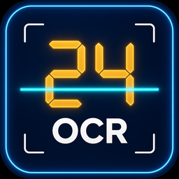

<div align="center">



# 光为 OCR

**Windows 便携记分牌 OCR。永久免费。MIT 许可证。**

场馆 LED / 七段管记分牌实时识别，把比分写成 JSON，供给 vMix / 芯象。

[下载（免安装）](https://ocr.4018.cn/) ·
[源代码](https://github.com/liuchixiangai/ocr) ·
[Code signing policy](docs/code-signing-policy.md) ·
[MIT](LICENSE)

用户支持 QQ 群：**124356408**

</div>

## 这是什么

光为 OCR（GuangWei OCR）是给体育直播用的 Windows 记分牌识别程序。摄像头或采集卡对准现场记分牌，软件读出比分、时间和节次，把结果写到桌面 `光为OCR输出\results.json`，供 vMix、芯象等导播软件绑定。

面向终端用户的发行形态是 **Windows 11 x64 免安装包**（可放在 U 盘里带走）。下载页：**<https://ocr.4018.cn/>**。当前下载文件是 `GuangWeiOCR-Portable.zip`（通道版本见 `src/product_brand.py` 的 `GW_RELEASE`，目前 `2026.10.26.1`）。解压到英文路径后运行 `启动光为OCR.bat` 或 `GuangWeiOCR.exe`。

**对终端用户永久免费**，没有账号、没有水印、没有付费档。本仓库源码以 [MIT](LICENSE) 发布。

这个包 **还没有** Authenticode 代码签名。Windows SmartScreen 可能提示未知发布者。校验下载站 `version.json` 里公布的 SHA-256。签名申请材料在 [Code signing policy](docs/code-signing-policy.md) 和 [docs/SIGNPATH_APPLICATION.md](docs/SIGNPATH_APPLICATION.md)。证书签发对象将是 **SignPath Foundation**，不是桐城市六尺巷网络有限公司。在 SignPath 批准并把签名步骤真正接上之前，不要把发行包说成已签名。

## 基于 ScoreSight

光为 OCR 是 [ScoreSight](https://github.com/royshil/scoresight) 的中文定制分支（上游文档：<https://royshil.github.io/scoresight/>）。ScoreSight 版权归 OCC AI（2024），MIT。本仓库保留该声明。

相对上游，这个分支主要改了这些地方：

- 中文界面和四步首次向导（`src/cn_first_run_wizard.py`）
- 桌面 JSON 出口，默认 `Desktop\光为OCR输出\results.json`，方便 vMix / 芯象
- LED 多帧融合和稳定窗口（`src/led_stabilize.py`）；比赛钟和 24 秒进攻钟默认不防抖，避免秒数滞后
- Windows 便携封装和 `ocr.4018.cn` 自动更新通道（`src/gw_auto_update.py`、`src/product_brand.py`）

上游的识别管线、PySide6 界面和大部分输出仍在。ScoreSight 的英文文档在 `docs/`，可以对照阅读。中文 vMix 说明见 [docs/vMix出站-白话.md](docs/vMix出站-白话.md)。

修改版权：liuchixiangai / 桐城市六尺巷网络有限公司（2026）。见 [LICENSE](LICENSE)。

## 本仓库里没有的东西

请直接按这个事实使用源码，不要假设权重已经在 git 里。

| 不在本仓库 | 本地或 CI 里怎么得到 |
|---|---|
| PP-OCR 权重（`ocr_models/ppocr/PP-OCRv6_*_rec/inference.onnx` 等） | `python scripts/fetch_models.py` 从 Hugging Face 按锁定的 revision 和 SHA-256 下载。本仓库只提交该目录的 Apache-2.0 `LICENSE` 和 `NOTICE`。 |
| Tesseract 模型（`tesseract/tessdata/*.traineddata`） | **没有**随这次开源树发布。ScoreSight 上游仓库和本地打包机上有 General Scoreboard、General Scoreboard Large、Daktronics、General Fonts。打包前从那里复制到 `tesseract/tessdata/`。 |
| `ocr_eval/` 评测数据和结果 | 上游评测说明见 `docs/development/ocr-eval.md`。评测集不在本树。 |
| `dist/`、`build/` | PyInstaller 产物，已 gitignore。 |
| 已签名的 exe、`.pfx`、HookSigntool | 不存在，也不应该提交。 |

`scoresight.spec` 在任一 data glob 匹配不到文件时会直接退出。因此在补齐 Tesseract `.traineddata` 并跑过 `scripts/fetch_models.py` 之前，**PyInstaller 打不出可运行的便携包**。下载站上的 `GuangWeiOCR-Portable.zip` 是维护者在本地打包机上做的未签名包，不是本仓库 CI 的产物。

从源码运行时：跑完 `fetch_models.py` 后可以用 PP-OCR。没有 `.traineddata` 时，Tesseract 模型不可用，`--self-test` 也会因缺少这四个文件而失败。

## 从源码运行（Windows）

需要 Python 3.13（64 位）、git，以及 Visual Studio 的 “Desktop development with C++”（用来编译摄像头枚举扩展）。

```powershell
git clone https://github.com/liuchixiangai/ocr.git
cd ocr
py -3.13 -m venv .venv
.\.venv\Scripts\Activate.ps1
python -m pip install -r requirements-dev.txt -r requirements-win.txt -r requirements-build.txt
python scripts/compile_ui.py
python src\win32DeviceEnum\setup.py build_ext --inplace
python scripts/fetch_models.py
# 将 ScoreSight 的 tesseract\tessdata\*.traineddata 复制到本仓库同名目录后再打包。
# 只从源码试用 PP-OCR 时可以先不复制，但 Tesseract 和 PyInstaller 不会成功。
python src\main.py
```

`requirements-build.txt` 里的打包工具是 **PyInstaller 6.22.3**。规格文件是仓库根目录的 `scoresight.spec`，产物是 `dist\scoresight\scoresight.exe`（onedir）。下载站上的文件名是 `GuangWeiOCR.exe` / `GuangWeiOCR-Portable.zip`，那个改名和启动 bat 在本地打包步骤里，**还没有**写进这个 CI。自动更新在找不到 `GuangWeiOCR.exe` 时会退回 `scoresight.exe`（`src/gw_auto_update.py`）。

更细的上游构建说明仍在 [docs/development/building.md](docs/development/building.md)。把里面的 clone 地址换成 `https://github.com/liuchixiangai/ocr.git`。

## 发行与签名

发 Windows 便携包时，自动更新看的是 `src/product_brand.py` 里的 `GW_RELEASE`，不是 `src/version.py`。必须两处一起改成**比现在更新**的同一个字符串，否则已经装好的用户启动时不会提示更新：

1. `python scripts/bump_gw_release.py 2026.10.26.1`（比当前 `GW_RELEASE` 新；`--dry-run` 只预览）
2. 上传 `GuangWeiOCR-Portable.zip` 后，把 <https://ocr.4018.cn/version.json> 的 `version` 改成同一个字符串，并写上 `zip_url` 和该 zip 的 SHA-256

说明见 [docs/gw-portable-release.md](docs/gw-portable-release.md)。`scripts/bump_version.py` 只改上游 ScoreSight 的版本号，结束时会提醒这一步，但不会改 `GW_RELEASE`。

- 用户下载：<https://ocr.4018.cn/>
- 计划中的 CI：`.github/workflows/windows-portable.yml`（`windows-latest`，仅 `workflow_dispatch`）。模型不全时它只说明缺什么，**不运行 PyInstaller，也不签名**。
- 签名政策：[Code signing policy](docs/code-signing-policy.md)
- 申请表草稿：[docs/SIGNPATH_APPLICATION.md](docs/SIGNPATH_APPLICATION.md)

## Code signing policy

代码签名政策见 [docs/code-signing-policy.md](docs/code-signing-policy.md)。

Free code signing provided by [SignPath.io](https://signpath.io)，certificate by [SignPath Foundation](https://signpath.org/)。**尚未批准，当前发行包未签名。**

## English

GuangWei OCR is a permanently free, MIT-licensed Windows 11 x64 portable app that reads a live sports scoreboard and writes JSON for vMix and 芯象. Download the unsigned portable zip from <https://ocr.4018.cn/>. Source is this repository.

It is a Chinese fork of [ScoreSight](https://github.com/royshil/scoresight) (MIT, copyright OCC AI 2024). Modifications by liuchixiangai / 桐城市六尺巷网络有限公司 cover the Chinese UI, vMix outbound files, LED debounce, portable packaging, and the `ocr.4018.cn` update channel. ScoreSight's copyright notice stays in [LICENSE](LICENSE).

PP-OCR weights are not in git (`python scripts/fetch_models.py` downloads them from Hugging Face; only `ocr_models/ppocr/LICENSE` and `NOTICE` are committed). Tesseract `.traineddata` files are not in this initial tree; copy `tesseract/tessdata` from a ScoreSight checkout before packaging. `scoresight.spec` fails closed without both. The zip on the download site was packaged locally and is not a signed CI artifact. See the [Code signing policy](docs/code-signing-policy.md). SignPath has not approved this project, and signing is not enabled.

Support QQ group: 124356408. Maintainer GitHub: [liuchixiangai](https://github.com/liuchixiangai).
