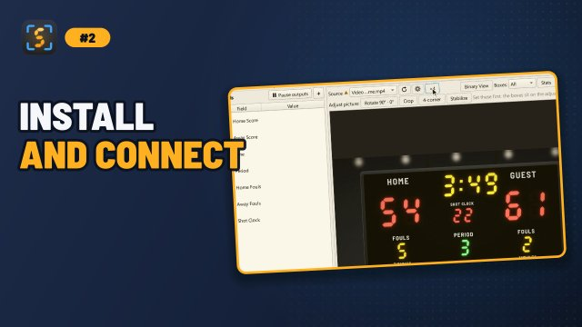
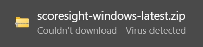
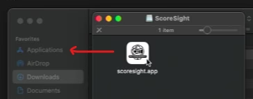

# Installation
{: .no_toc }

<details open markdown="block">
  <summary>On this page</summary>
  {: .text-delta }
1. TOC
{:toc}
</details>

<a href="https://youtu.be/6P1K4CpHUwM" target="_blank" rel="noopener"></a>

## Download

Official builds are published **only** on the GitHub Releases page:

**[github.com/royshil/scoresight/releases/latest](https://github.com/royshil/scoresight/releases/latest)**

Under **Assets**, pick the file for your computer (`<version>` is the release number, for example `0.2.0`):

| Your computer | File |
|---|---|
| Windows 10 (version 1809 or newer) or 11, 64-bit | `scoresight-<version>-windows-x64-setup.exe` (installer, recommended) or `scoresight-<version>-windows-x64-portable.zip` (no installation) |
| Mac with Apple Silicon (M1, M2, M3, M4...), macOS 15 or newer | `scoresight-<version>-macos-arm64.dmg` |
| Mac with an Intel processor, macOS 15 or newer | `scoresight-<version>-macos-x64.dmg` |
| Linux, 64-bit x86_64, glibc 2.35 or newer (Ubuntu 22.04+, Debian 12+) | `scoresight-<version>-linux-x64.tar.gz` |
| All | `SHA256SUMS.txt`: checksums for verifying the downloads |

Releases before 0.2.0 used other file names, for example a `windows` `.zip` that contained the installer, or `macos-x86` for Intel Macs.

{: .warning }
Do not download ScoreSight from any other website. The project's former website domain (`scoresight[.]live`) is **no longer controlled by the project**. ScoreSight 0.1.x and older still show links to it in the About and Update dialogs. Ignore those links.

Not sure which Mac you have? Open the Apple menu > **About This Mac**. If you see **Chip: Apple M...**, download `macos-arm64`. If you see **Processor: ... Intel**, download `macos-x64`.

## Verify your download (recommended)

Every release includes `SHA256SUMS.txt` with the SHA-256 checksum of each file (older releases list them in the release notes). Download it to the same folder as your file and compare:

Windows (PowerShell): compare the output with the file's line in `SHA256SUMS.txt`.
```powershell
Get-FileHash .\scoresight-*-windows-x64-setup.exe -Algorithm SHA256
```

macOS:
```bash
cd ~/Downloads
shasum -a 256 --check --ignore-missing SHA256SUMS.txt
```

Linux:
```bash
sha256sum --check --ignore-missing SHA256SUMS.txt
```

On macOS and Linux, a good download shows `OK` next to its name. If the checksum does not match, delete the file and download it again from the Releases page.

## Windows

1. Download `scoresight-<version>-windows-x64-setup.exe` from the [latest release](https://github.com/royshil/scoresight/releases/latest).
2. Run the installer. It asks whether to install ScoreSight **for all users** (the default, in `C:\Program Files\ScoreSight`, needs administrator rights) or **only for you** (no administrator rights needed). It adds a Start menu shortcut, and a desktop shortcut if you tick that option.
3. **SmartScreen**: since 0.3.2 the installer and the app are code-signed by **Roy Shilkrot**. A new release can still show "Windows protected your PC" until enough people have downloaded it. Click **More info**, check that the publisher is **Roy Shilkrot**, then click **Run anyway**. Do this only for a file you downloaded from the GitHub Releases page and verified.
4. **Windows Firewall**: the first time ScoreSight starts, Windows may ask whether to allow it on the network. ScoreSight runs a small [HTTP server](http_server.md) on port 18099 that browsers and other software can read. Allow it on **Private networks** only, unless you need access from a public network. See [SECURITY.md](https://github.com/royshil/scoresight/blob/main/SECURITY.md).

The installer refuses to run on Windows versions older than Windows 10 version 1809, which the Qt 6 framework doesn't support. If ScoreSight is running, the installer closes it first. Installing a new version over an existing ScoreSight, including 0.1.x, upgrades it in place.

Administrators can install silently with `scoresight-<version>-windows-x64-setup.exe /VERYSILENT` plus `/ALLUSERS` or `/CURRENTUSER`.

### Portable version (no installation)

Extract `scoresight-<version>-windows-x64-portable.zip` anywhere, for example to a USB stick, and run `scoresight\scoresight.exe`. Settings are still stored in your user profile, unless you set [`SCORESIGHT_DATA_DIR`](configuration.md#environment-variables).

### If your browser or antivirus blocks the download

ScoreSight is packaged with PyInstaller. Antivirus heuristics sometimes flag PyInstaller apps as false positives, especially unsigned ones (releases before 0.3.2) and new releases:



Do **not** turn off your antivirus or SmartScreen globally. Instead:

1. Make sure you downloaded the file from the [GitHub Releases page](https://github.com/royshil/scoresight/releases/latest) and that its [checksum matches](#verify-your-download-recommended).
2. In **Windows Security** > **Virus & threat protection** > **Protection history**, find the blocked item and choose **Restore** (or **Allow on device**) for that specific file only.
3. Report the false positive to Microsoft at [microsoft.com/wdsi/filesubmission](https://www.microsoft.com/wdsi/filesubmission) so future releases are not flagged.

### Uninstall (Windows)

Use **Settings** > **Apps** > **Installed apps** > **ScoreSight** > **Uninstall**. Your settings are kept. Delete the [settings folder](configuration.md#where-scoresight-keeps-its-files) too for a completely clean removal.

## macOS

ScoreSight 0.2.0 and newer require **macOS 15 (Sequoia) or newer**.

1. Download the `.dmg` for your Mac (Apple Silicon or Intel, see [Download](#download)).
2. Double-click the `.dmg`. It contains the ScoreSight app and a shortcut to your **Applications** folder. Drag ScoreSight onto **Applications**:

   

3. Eject the disk image and start ScoreSight from **Applications** or Launchpad.

ScoreSight is a regular app bundle, so it starts in a few seconds. macOS App Nap is turned off for it, so it keeps reading at full speed while its window is in the background.

### Gatekeeper

Official releases are signed and notarized by Apple, so macOS opens them normally. If you run a build that is not notarized (for example a test build from a pull request) and macOS says it "cannot be opened because Apple cannot check it for malicious software":

1. Open **System Settings** > **Privacy & Security**.
2. Scroll down to the message about ScoreSight and click **Open Anyway**, then confirm.

Only do this for builds you trust.

### Permissions

macOS asks for permission the first time ScoreSight uses a protected feature. If you clicked **Don't Allow** by mistake, you can change it later in **System Settings** > **Privacy & Security**:

| Feature | Permission | Where to change it |
|---|---|---|
| USB cameras and capture cards | **Camera** | Privacy & Security > **Camera** > enable ScoreSight |
| Screen / window capture | **Screen Recording** | Privacy & Security > **Screen & System Audio Recording** (named **Screen Recording** on older macOS) > enable ScoreSight, then **quit and restart** ScoreSight |
| NDI sources, OBS/vMix on other computers | **Local Network** | Privacy & Security > **Local Network** > enable ScoreSight |

{: .tip }
If a camera shows a black picture or screen capture shows only the desktop wallpaper, a missing permission is almost always the cause.

### Apple Silicon vs Intel

The Apple Silicon (`arm64`) build runs natively on M-series Macs and is much faster there. The Intel build also runs on Apple Silicon through Rosetta 2, but more slowly. Install the one that matches your Mac.

### Uninstall (macOS)

Drag ScoreSight from **Applications** to the Trash. To also remove settings and logs, delete `~/Library/Application Support/scoresight` and `~/Library/Logs/scoresight`.

## Linux

The Linux build runs on 64-bit x86_64 distributions with **glibc 2.35 or newer**, for example Ubuntu 22.04 or newer and Debian 12 or newer. Check your version with `ldd --version`.

1. Download `scoresight-<version>-linux-x64.tar.gz` from the [latest release](https://github.com/royshil/scoresight/releases/latest) and extract it. It contains a single `scoresight` folder:

   ```bash
   mkdir -p ~/Applications && cd ~/Applications
   tar -xzf ~/Downloads/scoresight-*-linux-x64.tar.gz
   ```

2. Run the `scoresight` executable inside that folder:

   ```bash
   ./scoresight/scoresight
   ```

   Keep the folder together: the executable needs the `_internal` folder next to it.

3. **Cameras**: your user must be allowed to open `/dev/video*` devices. On most distributions that means being in the `video` group:

   ```bash
   sudo usermod -aG video "$USER"   # then log out and back in
   ```

4. **Qt platform plugin errors**: packages older than 0.2.0 may not include `libxcb-cursor0` and the other xcb libraries that Qt needs (0.2.0 includes them). If ScoreSight exits with "Could not load the Qt platform plugin xcb", install the X11/xcb runtime libraries. On Debian/Ubuntu:

   ```bash
   sudo apt install libxcb-cursor0 libxkbcommon-x11-0 libegl1
   ```

{: .note }
Screen capture is not available on Linux. Use a capture card, NDI, or OBS's virtual camera to bring a screen into ScoreSight. See [Video Sources](sources.md).

## Upgrading

Install the new version over the old one (Windows), replace the app in Applications (macOS), or extract the new archive (Linux). Your boxes and settings live in a separate settings folder, so they carry over. See [Settings, Files & Command Line](configuration.md#where-scoresight-keeps-its-files).

### Update now (Windows)

When ScoreSight was installed with the Windows installer, the update dialog has an **Update now** button. ScoreSight downloads the new version's installer from the GitHub release and checks it: its SHA-256 must match the release's `SHA256SUMS.txt`, and it must be signed by the same publisher as the ScoreSight you run. It then runs the installer and closes. The new version is installed in the same folder and starts by itself. Windows may ask whether to allow the installer to make changes (an installation for all users): choose **Yes**. If you choose **No**, or something fails, ScoreSight keeps running and offers the release page.

While a source is open, ScoreSight asks first: the outputs stop until the new version runs. The portable zip, macOS and Linux don't have Update now: download the new version from the release page.

{: .new }
When ScoreSight 0.2.0 first opens the settings of an older version, it changes a saved vMix port of `8099` to `8088` (the port of vMix's Web API), and it sets the **Minimum confidence** (in 0.1.x: **Conf. Th**) of every box to 0 (off), because that setting had no effect before. Both changes happen once and are written to the log. See [One-time upgrades](configuration.md#one-time-upgrades-of-older-settings).

## Next step

Continue with the [Quickstart](quickstart.md).
