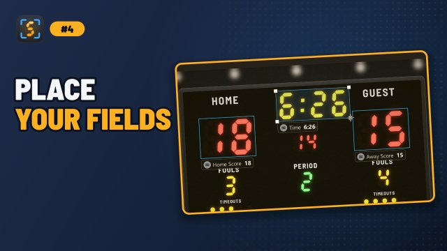
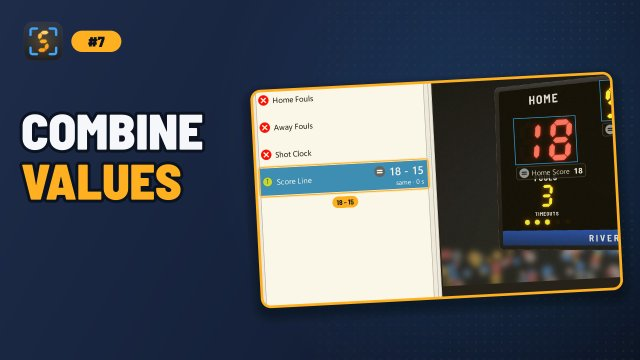

# Detection Boxes & Templates
{: .no_toc }

A **field** is a named value, such as *Home Score*, and its **box** is the rectangle over that value on the picture. ScoreSight reads every box on every detection cycle and publishes the result under the field's name.

The window has three parts: the **Fields** list on the left, the picture in the middle, and the **inspector** on the right, with a **Box** tab (the selected field's settings) and an **Outputs** tab. Drag the dividers between them to give one more room; ScoreSight remembers it. Double-click a divider (or drag it to the edge) to hide the Fields list or the inspector, and double-click it again to bring it back.

  
On this page

  {: .text-delta }
1. TOC
{:toc}

## Standard fields

The field list always contains seven standard fields. They cannot be renamed or deleted, and they come with sensible defaults:

| Field | Default Type | Default Format | OBS text source name |
|---|---|---|---|
| Home Score | Number | Score 1dd | `Home score` |
| Away Score | Number | Score 1dd | `Away score` |
| Time | Time | Time mm:ss.d | `Clock` |
| Period | Number | Period 1-4, with **Add ordinal suffix** on (1st, 2nd...) | `Period` |
| Home Fouls | Number | Any number | `#Home Fouls` |
| Away Fouls | Number | Any number | `#Away Fouls` |
| Shot Clock | Number | Shotclock 0-39 | `shotclock` |

The OBS name is the text source each field updates in OBS (see [OBS Studio](obs.md)).

## Custom fields

Use custom fields for anything else: downs, yards to go, balls/strikes/outs, sets and games, a second shot clock, team names, and so on.

- **Add**: click **+** at the top of the field list (or press **Ctrl+N**). A new field named *Custom 1* (*Custom 2*, ...) appears, selected.
- **Rename**: press **F2**, right-click it and choose **Rename...**, or (once it is on the picture) double-click it, then type a new name. Names must be unique, and names that differ only in upper and lower case count as the same (their text files would be the same file): ScoreSight says so and asks again. Choose names carefully, because they become file names, JSON keys and template placeholders, and with a [sport](game.md) chosen, ScoreSight finds the scores, the clock and the period by their names.
- **Delete**: select the field and click **Delete field** under the list (or right-click it). ScoreSight asks first. **Delete field** only shows for custom fields. **Del** (**Backspace** on a Mac) deletes a custom field that isn't on the picture; for one on the picture, the first **Del** takes its box off the picture.

Custom fields start as a Number field with the *Any number* format. Change the **Type** and **Format** in the Box tab.

## Placing a box

1. Open a source first: until the picture shows, the field list is greyed out and says *Open a source to place fields on the picture*.
2. Select a field in the list. Its icon is a red ✗ while it has no box. Over the picture, the pointer becomes a crosshair and a hint says *Drag over the numbers to place Home Fouls*.
3. Drag over the field's numbers on the picture. The box is drawn where you dragged (at any zoom, and on the rotated, cropped and corrected picture the boxes are read from). The icon turns into a green ✓, the box is selected, and the Box tab shows its settings. A drag of a few pixels counts as a click and draws nothing; **Esc** cancels a drag.

   Instead of dragging, you can:
   - double-click the field in the list: its box appears in the middle of the part of the picture you see, at its default size;
   - double-click the picture: the box appears there, centred where you double-clicked;
   - click **Place on picture** under the list (in ScoreSight 0.1.x: **Add to Scene**), which does the same as a double-click on the field, for the keyboard.

   Clicking another box on the picture selects that box, as usual: the drag places a box only from the picture around the boxes.
4. Drag the box to move it, and resize it with the edge and corner handles. To draw it again from scratch, hold **Alt** (**⌥ Option** on a Mac) and drag on the picture. For the last pixel, click the box and use the arrow keys (1 pixel; with Shift, 10). The label under the box shows its name and reading (see [Box display style](view-tools.md#box-display-style)).
5. To take a box off the picture, select its field (or click the box) and press **Del** (**Backspace** on a Mac), right-click the box and choose **Remove from picture**, or click **Remove from picture** under the list (in 0.1.x: **Remove Selected**). Its settings go back to the defaults; if you changed any of them, ScoreSight asks first.

The line above the button under the list says what to do with the selected field: *Drag on the picture to place it, or double-click the field* before it has a box, *Drag the box to move it · Del removes it* after.

Right-click a box on the picture for **Remove from picture**, **Rename...** (custom fields), **Hold value...** (and **Release held value**) and **Zoom to box**.

Boxes and their settings are saved automatically, about half a second after each change. A box that reaches past the edge of the picture is read from the part that is still inside the picture. When you change the crop, the boxes move with it, so they stay over the same digits (see [Crop](view-tools.md#crop)).

Tips for good boxes:

- One value per box. Read "12:34" as one Time box, but put the home and away scores in separate boxes.
- Leave a small margin around the digits (about a quarter of the digit height), but keep other text, logos and frame edges out of the box.
- Make the box wide enough for the largest value. A score box should fit "188", not just "88".
- For digits that sometimes disappear (for example a leading "1" that only lights up above 99), size the box for the full width anyway.

## Reading the field list

The **Value** column shows each box's last good reading in large type, so you can check the values at a glance during a game. Next to the value, a symbol shows the state of the latest reading (the symbol's shape, not only its colour, tells the states apart), and the line under it shows that state and how long ago the last good reading was made:

| Symbol | Line under the value | Meaning |
|---|---|---|
| ✓ (green) | *new · 0 s* | A new value was read |
| = (grey) | *same · 2 s* | The value hasn't changed |
| ! (amber) | *rejected ‘2l’ · 4 s* | Something was read, but it failed the box's **Format** or **Minimum confidence**. The value shown is still the last good one |
| ∅ (red) | *no reading · 4 s* | Nothing was read. The value shown is still the last good one |

- The age turns amber when the box hasn't had a good reading for a while (20 detection cycles, at least 10 seconds): check the box's position and settings.
- A dash (–) means the box hasn't had a good reading yet.
- While the outputs are paused, the values are marked *not sent*.
- A held value (see [Hold value](#hold-value)) shows an amber **HELD** chip, *held · OCR: 2nd* under it (what the OCR reads meanwhile) and a **Release** button when the list is wide enough.
- Click a value to select its field, as with a click on the name. Hover over it for the details.

Right-click a field for its actions:

| Action | Key | |
|---|---|---|
| **Place on picture** / **Remove from picture** | Double-click (a field without a box) / **Del** (**Backspace** on a Mac) | As the button under the list |
| **Rename...** | **F2**, or double-click a field on the picture | Custom fields |
| **Delete field...** | **Del** (**Backspace** on a Mac) for a field that isn't on the picture | Custom fields; asks first |
| **Reset settings to defaults** | | Its box's settings |
| **Copy value** | **Ctrl+C** | The last good reading (or the held value), to paste elsewhere |
| **Hold value...** | **Ctrl+H** (**⌃H** on a Mac) | Send a value you type instead of the readings; see [Hold value](#hold-value) |
| **Release held value** | | Send the readings again |
| **Zoom to box** | | Zooms the picture in on its box (**Ctrl+0** fits the whole picture again) |

**F2**, **Del** and **Ctrl+C** work while the field list has the focus (**F2** and **Del** also while the picture has it, on the selected box); **Ctrl+H** anywhere in the window.

## Setup and Live layouts

The window has two layouts of the same controls, in the **View** menu:

- **Setup layout** (**Ctrl+1**): for placing and tuning the fields and setting up the outputs. The field list, the picture with the **Adjust picture** row, and the inspector.
- **Live layout** (**Ctrl+2**): for the game. The inspector is hidden, the field list is wider (about 400 pixels) with the values in large type, and the fields that aren't on the picture are hidden (*Fields not on the picture: 3 hidden. Show them*, or **View > Show unused fields**). Under the readings, the **Outputs** list shows each output on one line with its state, for example *▲ vMix: Can't reach 192.168.1.40:8088 · retrying*; double-click one for its settings. The **Adjust picture** row and the buttons under the field list are hidden (the field's actions are in its right-click menu). Drawing a box on the picture, the double-clicks and the box's right-click menu work as in the Setup layout.

The reading and the outputs work exactly the same in both layouts. ScoreSight remembers the layout. Coming back to the Setup layout restores its widths. To adjust the picture during a game (a bumped camera), press **Ctrl+1**, then **Stabilize** or **4-corner**, then **Ctrl+2**.

## Hold value

When a field is misread during a game, or to freeze one field, hold its value: select the field and press **Ctrl+H** (or right-click it > **Hold value...**), check or type the value (it starts with the current one) and click **Hold**. From the next reading on, every output (text files, HTTP server, OBS, vMix, UNO, the outbound API) and every [template field](#template-fields) gets the held value instead of the readings: once as a new value, then as unchanged. The field's row shows **HELD** and the label on the picture says **HELD**. The OCR goes on reading the box in the background, and the row shows what it reads.

To send the readings again, click **Release** in the field's row, or right-click it > **Release held value** (or **Ctrl+H** > **Release**). The next good reading is sent as a new value, even if it equals the last one before the hold.

A held value isn't saved: it ends when ScoreSight closes, and when the field is taken off the picture. Renaming the field keeps it held. To freeze every output at once, use **Pause outputs** instead.

With a [sport](game.md) chosen, ScoreSight also holds back on its own a change the sport doesn't allow (21 becoming 81) until it is read steadily for 3 seconds ([Wrong readings stay off the air](game.md#wrong-readings-stay-off-the-air)). A value you hold is sent as it is, at once.

## Box settings

When a field is selected, the **Box** tab of the inspector shows its name and its recognition settings in three sections: **Reading** (**Type**, **Format**...), **Filtering** and **Image cleanup** (collapsed until you open it). Each box has its own settings; **Reset to defaults** restores the defaults for the selected box. With nothing selected, the Box tab explains how to select a field; for a field that isn't on the picture, it explains how to place it.

**All boxes**, at the bottom of the Box tab, holds the settings that apply to every box: the **OCR model**, **Detections / s** and **Update on change**.

Every setting is described in the [Per-Box Settings reference](box-settings.md), and [Recognition Tuning](recognition-tuning.md) explains which ones to use when.

## Template fields

A **template field** is a custom field with no box on the picture. Its value is built from other fields' values plus your own text. Use template fields to:

- combine values: `{{Home Score}} - {{Away Score}}` gives `65 - 39`
- add a prefix or suffix: `Q{{Period}}`, `{{Time}} left`, `{{Shot Clock}}s`
- build a full line for a lower third: `{{Custom 1}} & {{Custom 2}} to go`

To create one:

1. Click **+** to add a custom field, and rename it (for example *Score Line*). Don't place it on the picture.
2. In the **Template** section of the Box tab, tick **Build from other fields** (in ScoreSight 0.1.x: **Template Field**). Only custom fields that aren't on the picture can be templates.
3. Type the template into the text box. **Insert field** adds a field at the cursor, spelled exactly as the template needs it (fields that aren't on the picture yet are marked).

Rules:

- `{{Box Name}}` is replaced with the **last good reading** (green) of the box with exactly that name. Rejected (yellow) and empty readings never appear in a template: it keeps showing the box's last good value instead. The name is case-sensitive, so `{{home score}}` does not match *Home Score*.
- A template can use other template fields, for example `{{Score Line}} ({{Period}})`. Templates that refer to each other in a circle are always empty.
- Placeholders for boxes that don't exist are left as they are.
- Until every box the template uses has had a good reading, the template is empty (state `Empty`), so your graphics never show a half-filled line.
- Templates are evaluated on every detection cycle, and the result is sent to every output just like a normal box. A template is reported as a new value (`Success`) when its text changes and as unchanged (`SameNoChange`) when it doesn't, so outputs that only send new values send it only when it changes.
- Template fields don't appear on the picture and have no recognition settings.

{: .new }
In ScoreSight 0.1.x, templates used whatever text the boxes had last read, including rejected readings such as `SIM`, and a template was reported as a new value on every cycle. ScoreSight 0.2.0 uses only good readings and reports changes only.

To stop using a template, untick **Build from other fields**. The field becomes a regular custom field that you can place on the picture.

## Composite (per-character) boxes (experimental)

The **Per-character sub-boxes** checkbox (under *Experimental / legacy* in **Image cleanup**; in ScoreSight 0.1.x: **Composite (Per-Character)**) lets you draw small sub-boxes, one per character, inside a box: click the green **+** in the box to add one, then move and resize it. The sub-boxes are saved with your layout, but **in this release, recognition still reads the whole box**. Per-character recognition is planned for a future release. Leave this option off unless you are testing that work.

## Import and export layouts

- **File > Export field layout...** (**Ctrl+Shift+S**) saves all boxes (names, positions, settings including the **Type** and the OBS text source, and composite sub-boxes) to a `.json` file.
- **File > Import field layout...** (**Ctrl+O**) replaces the current boxes with the ones from a file.

(In ScoreSight 0.1.x: **Export Configuration** and **Import Configuration**.)

Exported files contain **boxes only**. The source, crop/rotation/4-corner settings and output settings (folders, OBS/vMix/UNO/API connections) are not included. To keep complete, separate setups, use [profiles](profiles.md).

{: .tip }
The OBS text source each field updates is set in the **Text sources** table of the OBS page (it is saved with the boxes, as `settings.obs_source_name`). Custom fields have none until you type one. See [OBS Studio](obs.md#custom-fields).
