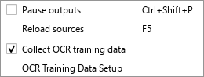
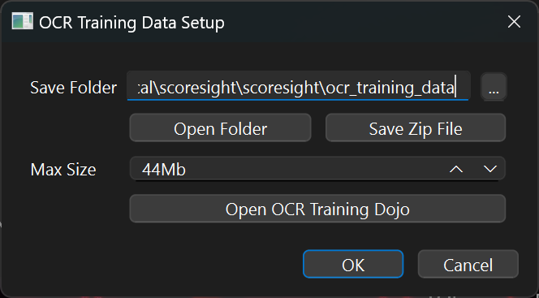
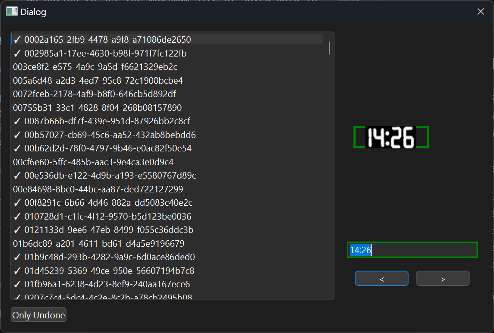
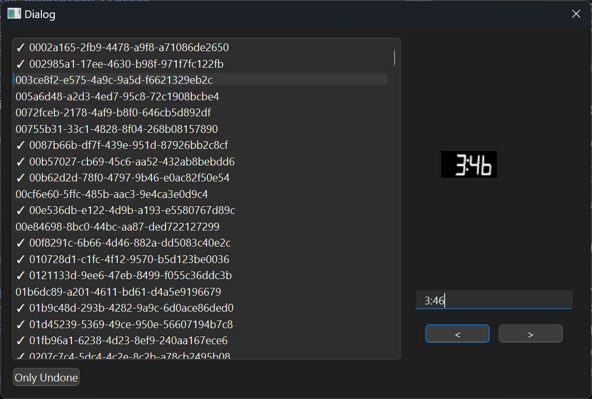

# OCR Training Data Collection and Annotation
{: .no_toc }

ScoreSight can save the image of every new reading together with the text it recognized. You can correct and approve those samples in the built-in **Training Dojo**, and then use them to train a Tesseract model for your scoreboard (see [OCR Models](ocr-models.md#training-a-model-for-your-scoreboard)).

  
On this page

  {: .text-delta }
1. TOC
{:toc}

## 1. Set up the training data folder

Open **Tools** > **OCR training data setup...** (it was in the **File** menu in 0.1.x):

| Control | What it does |
|---|---|
| **Save Folder** | Where samples are saved. Click **...** to choose a folder. The default is the `ocr_training_data` folder inside the ScoreSight [settings folder](configuration.md#where-scoresight-keeps-its-files) (and follows `SCORESIGHT_DATA_DIR`). Folders with non-ASCII characters in their path work on every platform. |
| **Open Folder** | Opens the folder in your file manager (Windows, macOS and Linux), creating it first if it doesn't exist yet. |
| **Save Zip File** | Packs the whole folder into a `.zip` file wherever you choose. |
| **Max Size** | The maximum size of the folder in MB (default 10). When the folder reaches it, ScoreSight stops saving new samples and writes one error to the log. It checks the folder again every 30 seconds and resumes saving when there is room again (for example after you moved samples out), or right away when you change **Max Size** or the folder. |
| **Open OCR Training Dojo** | Opens the annotation tool (see below). |

Click **OK** to apply your changes. ScoreSight creates the folder if needed. If it can't (for example on a read-only drive), it shows a warning and keeps the previous settings.

{: .new }
In ScoreSight 0.1.x a changed **Save Folder** was ignored and samples always went to the default folder ([#52](https://github.com/royshil/scoresight/issues/52)). This is fixed in 0.2.0: the folder you choose is used right away and remembered.

## 2. Collect samples

Choose **Tools** > **Collect OCR training data** to start collecting, and choose it again to stop. It replaces the **Save OCR Training Data** button of 0.2.0 (the setting is the same, so it stays on if it was on), and the choice is remembered. While it is on, the status bar shows **Collecting training data** with a red dot, so it doesn't fill the folder unnoticed; click it to open the setup:

While it is on, every new reading (green) and every reading rejected by a filter (yellow) saves three files per box into the training data folder. The rejected readings are often the most useful ones to annotate. Empty and unchanged readings, template fields and boxes that are entirely outside the picture are not saved:

| File | Content |
|---|---|
| `<id>.png` | The black-and-white image of the box, as the OCR saw it |
| `<id>_gray.png` | The grayscale image of the box |
| `<id>.txt` | The text ScoreSight recognized, UTF-8 (you correct it in the Training Dojo) |

Collect samples from a real game or a recording, so you capture all digits and the conditions you care about (lighting, angles, changing digits). A few hundred samples per box type is a good start.

Saving samples never interrupts recognition. If a sample can't be written, ScoreSight logs the error once and pauses saving for 30 seconds.

## 3. Annotate in the Training Dojo

Click **Open OCR Training Dojo** in the setup dialog.

- **Left**: all samples, sorted by name. Approved samples are shown in green with a ✓. Click a sample to open it.
- **Right**: the current image and a text box with its annotation. When a sample is approved, the image and text box are outlined in green.

For each image:

1. Check the text. If it is wrong, type the correct text.

   

2. Press **Enter** to approve it and move to the next image.

Tick **Only Undone** to show only samples you haven't approved yet. Your approvals are stored in `approved_annotations.json` in the training data folder, and corrected text is written back to the sample's `.txt` file (UTF-8). An empty folder, a sample without its `.txt` file or a damaged `approved_annotations.json` doesn't stop the Dojo from opening.

### Keyboard shortcuts

On macOS, use **⌘ Cmd** wherever this table says **Ctrl**.

| Key | Action |
|---|---|
| **Enter** | Approve the annotation and go to the next image |
| **Shift + Enter** | Go to the previous image |
| **Up** / **Down** | Previous / next image |
| **Ctrl + Up** / **Ctrl + Down** | Jump to the previous / next unapproved image |
| **Ctrl + N** / **Ctrl + B** | Next / back |
| **Ctrl + U** | Remove the approval from the current image |

The shortcuts also work while you type in the annotation box, and plain letters are always typed into the annotation. Moving to another image saves the text you typed to the sample's `.txt` file, without approving it. The tooltips of the **<** and **>** buttons and of the annotation box show the shortcuts.

{: .new }
In ScoreSight 0.1.x, the shortcuts were the plain letters **N**, **B** and **U**, so those letters couldn't be typed into an annotation.

## 4. Export and use the data

1. In **OCR training data setup...**, click **Save Zip File** and choose where to save the archive.
2. Use the approved samples (each `.png` with its `.txt`) to train or fine-tune a Tesseract model with [tesstrain](https://github.com/tesseract-ocr/tesstrain). Then load it with **OCR model** > **Load external model...** (under **All boxes**, in the Box tab).

If you'd like your data to help improve the models bundled with ScoreSight, [open an issue](https://github.com/royshil/scoresight/issues/new/choose) describing your scoreboard and the size of your dataset, and the maintainers will reply there. Please don't attach large archives to an issue without asking first.

## Best practices

1. Annotate regularly, a few hundred samples at a time.
2. Use the keyboard shortcuts. **Enter** to approve and continue is the fastest workflow.
3. Double-check before approving. One wrong label teaches the model the wrong thing.
4. Use **Only Undone** when you're nearly done to find the remaining samples.
5. Set a reasonable **Max Size** so collection doesn't fill your disk during a long game.
