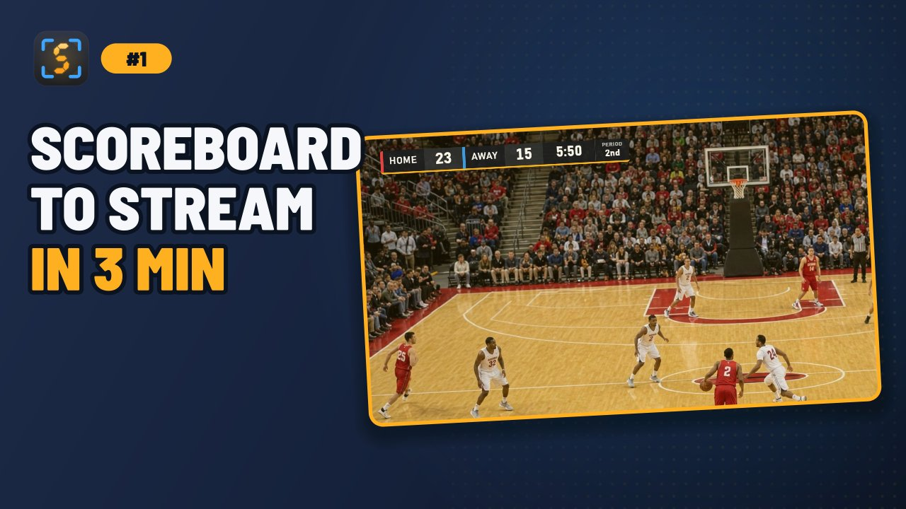
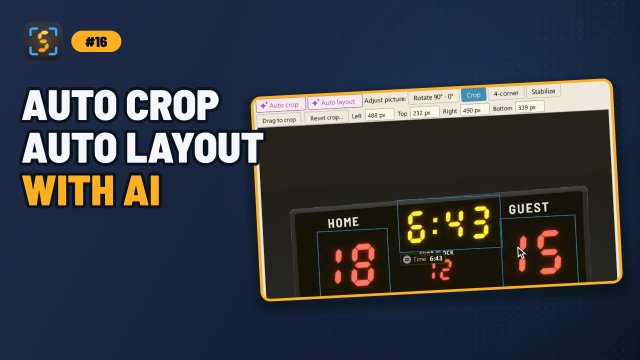

# ScoreSight documentation
{: .fs-9 }

Real-time scoreboard OCR for live production. Free, open source, and available for Windows, macOS and Linux.
{: .fs-6 .fw-300 }

[Download ScoreSight](https://github.com/royshil/scoresight/releases/latest){: .btn .btn-primary .fs-5 .mb-4 .mb-md-0 .mr-2 }
[Quickstart](quickstart.md){: .btn .fs-5 .mb-4 .mb-md-0 .mr-2 }
[View on GitHub](https://github.com/royshil/scoresight){: .btn .fs-5 .mb-4 .mb-md-0 }

---

ScoreSight reads text and numbers from a live video feed (a stadium scoreboard filmed by a camera, a capture card, an NDI feed, an RTSP stream, a window on your screen or a video file). It sends the values to your production tools many times per second. You draw a box around each value you care about, such as the home score, the clock or the period. ScoreSight then reads every box with [PaddleOCR's PP-OCRv6](https://github.com/PaddlePaddle/PaddleOCR) text recognition models (or [Tesseract OCR](https://github.com/tesseract-ocr/tesseract)) and publishes the results to text files, a built-in HTTP server, OBS, vMix, overlays.uno, or any HTTP endpoint you choose.

## Start here

| I want to... | Go to |
|---|---|
| Install ScoreSight | [Installation](INSTALL.md) |
| Read my first scoreboard in five minutes | [Quickstart](quickstart.md) |
| Connect a camera, NDI feed, RTSP stream, screen or video file | [Video Sources](sources.md) |
| Get the data into OBS, vMix, UNO, a browser or my own app | [Outputs](outputs.md) |
| Use it with Wirecast, XSplit, TriCaster, CasparCG, Chyron, XPression, Vizrt, CharacterWorks, Captivate... | [Works With…](integrations.md) |
| Follow the game: each score, period and the final buzzer | [Game & Sports](game.md) |
| Fix readings that are wrong or flicker | [Recognition Tuning](recognition-tuning.md) |
| Run two scoreboards or cameras at once | [Multiple Instances & Profiles](profiles.md) |
| Fix a problem | [Troubleshooting](troubleshooting.md) and [FAQ](faq.md) |
| Build ScoreSight or contribute | [Developer Guide](development/index.md) |

## How it works

1. **Capture**: ScoreSight grabs frames from your [source](sources.md).
2. **Correct**: Optional rotation, cropping, stabilization and 4-corner perspective correction make the scoreboard flat and steady ([Viewer & Image Tools](view-tools.md)).
3. **Read**: Every [detection box](boxes.md) is read by an [OCR model](ocr-models.md) (PP-OCR by default, or Tesseract, which first cleans the box up according to its [per-box settings](box-settings.md)), then checked against the box's format.
4. **Validate**: Format rules (for example "a clock looks like `mm:ss`") reject impossible readings before they reach your graphics.
5. **Publish**: Results go to every [output](outputs.md) you enabled. Outputs run in the background, so a slow or offline target never freezes the app.

## Video tutorials

A short series on the current version, from the first source to your graphics. The guides show the matching video at the top of their page.

Older videos, about earlier versions of ScoreSight: [ScoreSight with vMix](https://youtu.be/yowoYzBWrps) (vMix now uses port **8088**; see the [vMix guide](vmix.md)), [ScoreSight with NewBlue Captivate](https://youtu.be/ptR-Yh5FSPg) and [collecting OCR training data](https://youtu.be/QO76EFmJ7Ig).

## Getting help

- Search these docs (the search box at the top) and read [Troubleshooting](troubleshooting.md).
- Ask in [ScoreSight's Discussions](https://github.com/royshil/scoresight/discussions): questions in [Q&A](https://github.com/royshil/scoresight/discussions/categories/q-a), ideas in [Ideas](https://github.com/royshil/scoresight/discussions/categories/ideas), and your production in [Show and tell](https://github.com/royshil/scoresight/discussions/categories/show-and-tell). In the app, click **Feedback** at the right end of the status bar.
- Look through [existing issues](https://github.com/royshil/scoresight/issues?q=is%3Aissue).
- [Open a new issue](https://github.com/royshil/scoresight/issues/new/choose) and attach your log files. [Troubleshooting](troubleshooting.md#collect-logs-first) explains where to find them.
