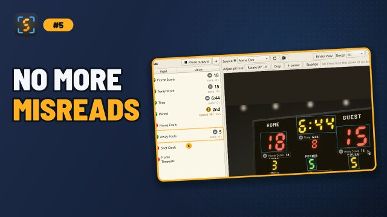

# OCR Models

ScoreSight reads the boxes with one of two OCR engines:

- **PP-OCR**, PaddleOCR's [PP-OCRv6](https://github.com/PaddlePaddle/PaddleOCR) text recognition models (since 0.3.0, the default for new setups);
- **Tesseract**, the [Tesseract](https://github.com/tesseract-ocr/tesseract) engine with models trained for scoreboards (the only engine before 0.3.0).

Choose the model in the **OCR model** list, under **All boxes** at the bottom of the **Box** tab (on the right of the main window). The model applies to **all** boxes and is remembered between runs. A setup made with an earlier version keeps its Tesseract model until you choose another one.

## The models

| Menu name | Engine | Use for |
|---|---|---|
| **PP-OCR (automatic)** (default) | PP-OCRv6 small or tiny | Almost everything. Reads with *accurate* while your computer keeps up with **Detections / s**, and with *fast* when it doesn't |
| **PP-OCR (accurate)** | PP-OCRv6 small | The most accurate, always, if your computer can afford it (see below) |
| **PP-OCR (fast)** | PP-OCRv6 tiny | Many boxes, a high **Detections / s**, a laptop or an older computer |
| **Tesseract: Daktronics** | Tesseract | Daktronics-style LED and dot-matrix scoreboard fonts |
| **Tesseract: General Scoreboard** | Tesseract | LED, LCD and 7-segment scoreboard digits (the default before 0.3.0) |
| **Tesseract: General Fonts (English)** | Tesseract | Regular fonts: TV score bugs, games, apps, web pages, printed text |
| **Tesseract: General Scoreboard Large** | Tesseract | Large, bold segment digits. Slower than the others |
| **Load external Tesseract model...** | Tesseract | A model you trained yourself (see below) |

The models are installed with ScoreSight: PP-OCR's in the `ocr_models/ppocr` folder of the application (with their Apache-2.0 license), Tesseract's in `tesseract/tessdata`.

### How much better is PP-OCR?

On 2,040 real scoreboard crops of the kind a ScoreSight user would box (scores, clocks, periods, fouls and team names from photos of real scoreboards; the [OCR evaluation](development/ocr-eval.md) has the details), with every box at its default settings:

| Model | Read exactly |
|---|---:|
| PP-OCR (accurate) | 95% |
| PP-OCR (fast) | 90% |
| Tesseract: General Fonts (English) without binarization, the best untuned Tesseract setup | 46% |
| Tesseract: General Scoreboard | 31% |

PP-OCR (fast) misreads about twice as many values as accurate, mostly where scoreboards are hard: clocks, team names, bulb boards and LCDs. Tesseract can do better than its defaults with per-board tuning of the Image cleanup settings, but not close to PP-OCR.

### Fast or accurate: the CPU cost

PP-OCR (accurate) needs about five times the CPU of PP-OCR (fast). Reading 10 boxes 5 times a second (the default **Detections / s**):

| Model | Share of one fast desktop core (an Intel i9 performance core) | Share of one slower core (the same CPU's efficiency core, like a laptop's) |
|---|---:|---:|
| PP-OCR (accurate) | 83% | 213% |
| PP-OCR (fast) | 15% | 43% |
| Tesseract: General Scoreboard | 10% | 17% |

(One thread, measured in the [OCR evaluation](development/ocr-eval.md); a laptop core about half as fast as the desktop's would put PP-OCR (accurate) near 170%.) ScoreSight runs PP-OCR on two threads, so a frame's boxes are read in about half that time, but on a laptop PP-OCR (accurate) often can't read 10 boxes 5 times a second. That is what **PP-OCR (automatic)** is for: it starts with accurate, measures how long a frame's boxes take, and switches to fast when accurate needs more than 70% of the time between detections for 3 seconds in a row (for example more than 140 ms at 5 detections per second). It goes back to accurate when accurate would need less than half that time for 10 seconds, for example after you lower **Detections / s** or remove boxes. It never switches silently: the list shows **PP-OCR (automatic: fast)** or **(automatic: accurate)** while a source is read, and its tooltip and the status bar's reading rate say why, for example *PP-OCR automatic: fast (accurate needs 160 ms per reading here, more than 70% of the 200 ms between readings)*.

**PP-OCR (accurate)** and **PP-OCR (fast)** never switch. If you choose accurate and your computer can't keep up, the status bar's *Reading x/s of y* turns amber, its tooltip suggests PP-OCR (fast) or a lower Detections / s, and ScoreSight shows a one-time message with a **Use PP-OCR (fast)** button. Other ways to save CPU, with any model: lower **Detections / s** (2–3 is plenty for scores), and turn on **Skip OCR while image is unchanged** for boxes whose value rarely changes.

ScoreSight reads the boxes on a thread of its own, so even a slow model never holds up the video: the picture stays live and readings arrive as soon as they are made.

## How ScoreSight runs PP-OCR

- PP-OCR reads each box's **colour picture as it is** (after the picture adjustments: rotation, crop, stabilization, four-corner correction). Binarizing or otherwise cleaning up the picture makes it read much worse, so the **Image cleanup** settings of the [Box tab](box-settings.md#image-cleanup) don't apply: they are disabled, and kept, with a note, while a PP-OCR model reads. They still apply to a box that **counts lights (dot counter)**, which counts the lights in the cleaned-up picture whatever the model.
- The **Type** of the box limits the characters PP-OCR may output, as with Tesseract (below): a *Number* box can't read an `l` or an `O`, only the digit closest to it.
- All boxes of a frame are read together.
- PP-OCR's **confidence** is reliable: with **Minimum confidence** at 80–90%, a box rejects most wrong readings and keeps its last good value instead. Set it while watching your scoreboard: a box whose readings never reach it never updates.
- After recognition, the same [format, confidence and smoothing filters](box-settings.md#processing-order) as with Tesseract apply.
- **Binary view** shows what PP-OCR reads of each box: its picture (in gray).

The first time PP-OCR is chosen, its model takes a fraction of a second to load in the background; the status bar says *Loading PP-OCR…* meanwhile. If it can't load, ScoreSight reads the boxes with Tesseract: General Scoreboard instead, and the status bar says so (the log has the details).

**Running from source:** the PP-OCR models aren't in the source repository. Download them with `python scripts/fetch_models.py`; until then the PP-OCR items are disabled and ScoreSight reads with Tesseract. See [Building from Source](development/building.md).

## How ScoreSight runs Tesseract

Knowing this helps when you train your own model:

- Each box is read as a **single word** (Tesseract page segmentation mode 8), so one box should contain one value.
- The **Type** of the box restricts the characters Tesseract may output:
  - *Number*: `0123456789`
  - *Time*: `0123456789:.`
  - *Text*: letters, digits, space and common punctuation
- Before recognition, the box image is pre-processed according to its [Image cleanup settings](box-settings.md#image-cleanup) and, with **Resize to 35 px** on (the default), scaled to 35 pixels high.
- After recognition, the [format, confidence and smoothing filters](box-settings.md#processing-order) are applied.

## Loading your own Tesseract model

1. Choose **Load external Tesseract model...** in the **OCR model** list.
2. Pick a `.traineddata` file.

ScoreSight uses the file's folder as the Tesseract data folder and the file name (without `.traineddata`) as the language. For example, `D:\models\myboard.traineddata` loads language `myboard` from `D:\models`. The path is remembered, so keep the file where it is.

## Training a model for your scoreboard

1. [Collect and annotate training data](data_annotation.md) from your own scoreboard with the built-in Training Dojo.
2. Train a Tesseract LSTM model with the official [tesstrain](https://github.com/tesseract-ocr/tesstrain) tools. Fine-tuning one of the bundled scoreboard models usually needs far less data than training from scratch.
3. Load the resulting `.traineddata` with **Load external Tesseract model...**.

Training is an advanced topic. If you want to share data or a model that could help other users, [open an issue](https://github.com/royshil/scoresight/issues/new/choose) to discuss it.
