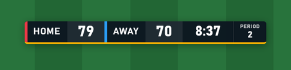
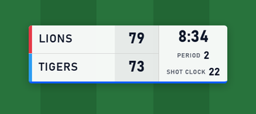
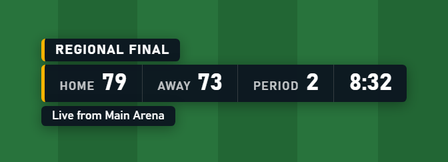
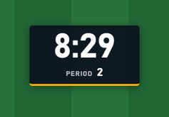
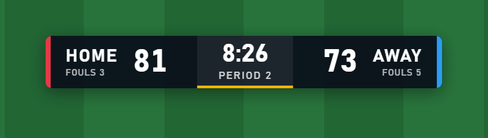

# Browser Overlays
{: .no_toc }

ScoreSight's [HTTP server](http_server.md) serves ready-made **overlay pages**: a scorebug, a lower third, a clock and single fields, with a transparent background, updated live as the readings change. Any production software that can show a web page as a graphics layer can use them: OBS Browser Source, vMix Web Browser input, Wirecast Web Page source, CasparCG's HTML producer, TriCaster Live Link, Magewell Director Webpage GFX, Epiphan Pearl Web Graphics and others. You can also design your own overlays in HTML and let ScoreSight serve them.

<a href="https://youtu.be/2i_7QR6-yKY" target="_blank" rel="noopener"></a>

<details open markdown="block">
  <summary>On this page</summary>
  {: .text-delta }
1. TOC
{:toc}
</details>

## Quick start

1. In ScoreSight, open the **Outputs** tab and select **HTTP server**.
2. Under **Browser overlays**, choose an **Overlay**, its **Fields**, the **Teams** (the home and away team names; empty shows HOME and AWAY), **Theme** and **Scale**, and the **Address**: the network address when the production software runs on another computer, `localhost` when it runs on this one. The overlay shows the fields in the order you tick them (untick and tick a field to move it last): on the scorebug the first two are the home and away scores and the third is the clock. Each overlay keeps its own theme.
3. Click **Copy** and paste the address into your software's browser source. Set the source to your video size, for example **1920×1080** or **1280×720**. **Open in browser** shows the overlay in your web browser first.



The overlays are transparent outside their panels, so they key over your video without any extra settings. They follow the page width: the same overlay looks the same at 1920×1080, 1280×720 or 3840×2160.

`http://<scoresight-ip>:18099/overlay` lists every overlay (built-in and your own) and the live values, which is handy for checking the connection from the production computer.

## Built-in overlays

| Overlay | Address | Shows (by default) |
|---|---|---|
| Scorebug | `/overlay/scorebug` | Home and away scores with team names, the clock, then small cells for the other fields (Period) |
| Lower third | `/overlay/lower-third` | A bar of label-value pairs (Home, Away, Period, Time), with an optional title and subtitle |
| Clock | `/overlay/clock` | The clock large, the other fields (Period) small under it |
| Single field | `/overlay/field?name=Shot%20Clock` | One field's value (Time by default), white text with a shadow |

  

Until a field has a good reading, it shows a dash. A field keeps its last good value when a reading is rejected or empty, and also when ScoreSight stops or the connection drops, so a graphic on air never goes blank. A score that changes pops briefly; clocks (fields whose name contains *Time* or *Clock*) don't animate.

### Options

Add options to the address after a `?`, separated by `&`, for example `/overlay/scorebug?theme=light&scale=1.5`. The builder in ScoreSight sets **fields**, **theme**, **scale** and, on the scorebug and the lower third, the first two **labels** (**Teams**); the others you add by hand. Unknown or invalid values are ignored (the default is used), so an overlay address never fails.

| Option | Values | Default |
|---|---|---|
| `fields` | Field names separated by commas, in display order: `fields=Home%20Score,Away%20Score,Time`. For names that contain a comma, repeat `field=` instead: `field=A&field=B` | The standard fields (above) |
| `name` | The field of `/overlay/field` | `Time` |
| `labels` | Captions in the same order as the fields, separated by commas; leave one empty to keep its default: `labels=Lions,Tigers,,QTR`. On the scorebug the first two are the team names. `label=` can be repeated instead | `HOME`, `AWAY`, then the field names (`Home Score` shows as *Home*, `Time` has none) |
| `theme` | `dark`, `light`, `minimal` (no panels: white text with a shadow), `bold` | `dark` (`minimal` for `/overlay/field`) |
| `accent`, `bg`, `fg`, `home`, `away` | Colours: accent line, panel background, text, home and away team colours. Hex without `#` (`ff0000`, `f00`, or `1d3557e6` with transparency) or a CSS colour name (`navy`) | The theme's |
| `font` | `condensed`, `sans`, `serif`, `mono`, or the name of a font installed on the computer that renders the page (`font=Arial%20Black`) | `condensed` |
| `scale` | `0.25` to `4` | `1` |
| `fit` | `width`: sizes follow the page width (designed for 1920 px). `none`: fixed sizes (as at 1920×1080) whatever the page size | `width` |
| `position` | `top-left`, `top`, `top-right`, `left`, `center`, `right`, `bottom-left`, `bottom`, `bottom-right`, inside a 5 % safe margin | Scorebug `top-left`, lower third `bottom-left`, clock `top-right`, field `center` |
| `layout` | Scorebug: `row` (one line) or `stack` (the teams on two rows, the clock beside them) | `row` |
| `animate` | `pop`, `fade`, `slide`, `none` | `pop` |
| `title`, `subtitle` | Lower third: text above and below the bar | none |
| `transport` | `auto`, `poll` (see [Live updates](#live-updates)) | `auto` |
| `poll` | Polling interval in milliseconds, `100` to `10000` | `500` |

Fonts come from the computer that shows the page (no web fonts are downloaded: broadcast machines are often offline). `condensed` uses Bahnschrift (Windows 10 and later), DIN Alternate (macOS) or Roboto Condensed when available, and falls back to Arial.

## Live updates

The overlays don't poll ScoreSight several times a second. They keep one connection open and ScoreSight **pushes** each change as it happens (Server-Sent Events), so values appear within a frame or two of the reading and an idle overlay costs almost nothing, even on a small device.

- When the connection drops (ScoreSight restarts, the network blips), the page reconnects by itself within a few seconds and gets the current values. A connection that goes silent (a sleeping computer, a pulled cable) is noticed within about 20 seconds and reopened.
- Browsers keep at most 6 connections open to one server. All the ScoreSight overlays open in one browser (tabs, or browser sources that share one engine) therefore share a single connection.
- Where the push connection can't work (an engine without EventSource, or a proxy that holds it back), the page polls `/overlay/state` every half second instead. Add `?transport=poll` to force polling.

If the browser source was loaded while ScoreSight wasn't running, the page couldn't load at all: refresh the source once ScoreSight runs (in OBS, **Refresh cache of current page** in the source's properties).

## Your own overlays

Put your own HTML pages, with their styles, scripts, images and fonts, in the **overlays** folder in ScoreSight's settings folder. ScoreSight creates it the first time it starts, with an example overlay (`example.html`). The folder button next to the **Overlay** list opens it.

| Windows | macOS | Linux |
|---|---|---|
| `%LOCALAPPDATA%\scoresight\scoresight\overlays` | `~/Library/Application Support/scoresight/overlays` | `~/.local/share/scoresight/overlays` |

A file `<folder>/my-board.html` is served at `http://<scoresight-ip>:18099/overlay/custom/my-board.html`, and subfolders work too (`/overlay/custom/basketball/board.html`). The **Overlay** list in ScoreSight shows every `.html` file of the folder (it is read again each time the list opens).



### The overlay contract

Load ScoreSight's client and mark the elements that show values with `data-field` and the field's exact name:

```html
<!DOCTYPE html>
<html>
<head>
<style>
  html, body { background: transparent; }
  .score.ss-changed { animation: pop .6s; }
  @keyframes pop { from { transform: scale(1.4); } }
</style>
</head>
<body>
  <span class="score" data-field="Home Score">0</span> -
  <span class="score" data-field="Away Score">0</span>
  <span data-field="Time">0:00</span>

  <script src="/overlay/client.js"></script>
  <script>
    ScoreSight.on("change", function (change) {
      if (change.field === "Home Score" && !change.initial) {
        console.log("Home scored:", change.previous, "->", change.value);
      }
    });
  </script>
</body>
</html>
```

What `/overlay/client.js` does:

- **Values.** Every element with a `data-field` attribute gets the field's last good value as its text (never as HTML). Until the field has a good reading, the element keeps the content you wrote in it. Elements added later are filled by `ScoreSight.render()`.
- **Attributes.** It sets `data-state` (`Success`, `SameNoChange`, `FailedFilter`, `Empty`, or `Missing` for a field that doesn't exist) and `data-empty` (`"true"` until the field has a value) on those elements, so CSS can style them, for example `[data-empty="true"] { opacity: .4 }`. The `<html>` element gets `data-ss-connected="true"` or `"false"`.
- **Class.** It adds the class `ss-changed` to an element for one second when its value changes (not for the first value), restarting it on each change: use it for animations.
- **Events**, fired on `document` (also through `ScoreSight.on(name, function (detail) {...})`):

  | Event | `detail` | When |
  |---|---|---|
  | `scoresight:change` | `{field, value, previous, state, good, initial, removed}` | A field's value changed; `initial` is true for the first value after the page loads, `removed` when the field no longer exists (its box was deleted or renamed) |
  | `scoresight:update` | `{fields, changed, snapshot}` | After each update: all the fields, the names of those that changed (value or state) |
  | `scoresight:connection` | `{connected, transport}` | The connection to ScoreSight came or went; `transport` is `"sse"` or `"poll"` |

- **The `ScoreSight` object**: `ScoreSight.fields` (name → `{value, state, good}`), `ScoreSight.get("Home Score")` (the value or `null`), `ScoreSight.connected`, `ScoreSight.transport`, `ScoreSight.on(...)` and `ScoreSight.render()`.
- **Options** on the script tag: `data-transport="poll"`, `data-poll-ms="250"`, `data-changed-ms="1500"` (how long `ss-changed` stays), `data-shared="false"` (don't share the connection with the other overlay pages), and `data-server="http://192.168.1.20:18099"` (another server than the one the script came from). `?transport=`, `?poll=` and `?shared=` in the page's address override them.

The client is plain JavaScript (ES5) without dependencies, so it also runs in older embedded browsers. Values are field names exactly as in the fields list, including spaces and capitals; template fields work like any other field.

### Overlays hosted elsewhere

A page that isn't served by ScoreSight (a file in CasparCG's templates folder, a file opened in a browser source, a page on another web server) can use the client too: load it with ScoreSight's full address. The client then talks to the server it came from (ScoreSight allows requests from any origin):

```html
<script src="http://192.168.1.20:18099/overlay/client.js"></script>
```

Such a page opens its own connection (it can't share the one of the overlays that ScoreSight serves).

### What is served

Only files inside the overlays folder are served, of these types: `.html`, `.htm`, `.css`, `.js`, `.mjs`, `.json`, `.txt`, `.svg`, `.png`, `.jpg`, `.jpeg`, `.gif`, `.webp`, `.avif`, `.ico`, `.woff`, `.woff2`, `.ttf`, `.otf`, `.mp4`, `.webm`, `.mp3`, `.ogg`, `.wav`. Files and folders whose name starts with a dot are never served, and neither is anything outside the folder (`..`, absolute paths, links that point out). Files are sent with `Cache-Control: no-cache`, so a changed file shows on the next refresh.

### Live values for developers

The overlays' data is available to any client:

| Endpoint | Returns |
|---|---|
| `GET /events` | Server-Sent Events (`text/event-stream`): `snapshot` on connect, then `change` events, and `heartbeat` every 5 seconds |
| `GET /overlay/state` | The current snapshot as JSON (for polling) |

```text
event: snapshot
data: {"version":7,"fields":{"Home Score":{"value":"21","state":"Success"},"Time":{"value":"4:30","state":"SameNoChange"}}}

event: change
data: {"version":8,"fields":{"Time":{"value":"4:29","state":"Success"}}}

event: change
data: {"version":9,"fields":{},"removed":["Old box"]}

event: heartbeat
data: {"version":9}
```

`value` is the field's last good reading (`null` until it has one) and `state` is the state of its latest reading (see [States](http_server.md#states)). A `change` lists only the fields whose value or state changed. `version` increases with each change while ScoreSight runs and starts over when it restarts, so compare versions only for equality. A client that reconnects gets a fresh snapshot.

## Adding the overlay in your software

The steps below come from each vendor's documentation. **None of these products has been tested with ScoreSight's overlays yet**: they were checked in Microsoft Edge (Chromium, the engine most of these products embed), with live values, transparency, 1920×1080 and 1280×720, reconnecting after a ScoreSight restart, and 10 overlays open at once. Please report what works (or doesn't) in your setup.

In all of them, use the network address of the ScoreSight computer (`http://192.168.x.x:18099/...`) when the software runs on another computer, and allow ScoreSight through that computer's firewall (port 18099).

### OBS Studio

1. **+** in Sources > **Browser**.
2. **URL**: the overlay address. **Width** / **Height**: your canvas, for example 1920 × 1080.
3. Leave **Custom CSS** as it is (OBS's default makes the background transparent; the overlays already are).

Notes:
- The page is served by ScoreSight itself, so OBS 33's stricter rules for pages that reach into the local network (Chromium's Local Network Access checks) don't apply.
- Several ScoreSight overlays in OBS share one connection when OBS runs its browser sources in one engine. If an overlay stays empty while others work, add `?transport=poll` to its address.
- **Shutdown source when not visible** is fine: the overlay gets the current values when it comes back.
- The [OBS output](obs.md) (text sources over the OBS WebSocket) is an alternative that needs no browser source.

### vMix

1. **Add Input** > **Web Browser**.
2. Enter the overlay address, and set the size to your production format (1920 × 1080).
3. Put the input on an overlay channel. The background is transparent because the overlay page has no background colour.

Notes: vMix renders web pages with an embedded Chromium; the client is plain ES5, so it works whichever browser version your vMix uses. The built-in [vMix output](vmix.md) (GT title fields over the Web API) is an alternative.

### Wirecast

1. **Add Shot** > **Web Page**.
2. **URL**: the overlay address. **Width** / **Height**: 1920 × 1080 (or your canvas). Tick **Transparent Background**.

Notes: Wirecast uses WebView2 on Windows (since 14.x). Web Page sources are in Wirecast Studio and Pro. **Shutdown when inactive** is fine. Wirecast's text sources can also read ScoreSight's [text files](text-files.md).

### CasparCG

Play the overlay with the HTML producer, on a layer above your video:

```text
PLAY 1-20 [HTML] "http://192.168.1.20:18099/overlay/scorebug"
```

`STOP 1-20` or `CLEAR 1-20` takes it off. The page sets its own values, so it doesn't use CasparCG's `CG ADD` / `CG UPDATE` template data.

Notes:
- CasparCG renders HTML with an embedded Chromium (CEF; CasparCG 2.5 has CEF 142, the 2.3 LTS line a much older one). Frames have an alpha channel, so a transparent page keys over video; this hasn't been tested on a real server.
- A template in CasparCG's templates folder is loaded as a `file://` page: load the client with ScoreSight's full address (see [Overlays hosted elsewhere](#overlays-hosted-elsewhere)). Whether CasparCG's CEF lets a `file://` page reach the network hasn't been tested; the `PLAY [HTML] "http://..."` form above avoids the question.
- Several overlays on different layers share one connection (they run in one engine).

### TriCaster (Vizrt)

1. Hover one of the first 10 buffer slots, click **+** to open the Media Browser, and choose **Web Browser** (Live Link).
2. Enter the overlay address.
3. Use the buffer in a DSK or as a key source.

Notes: Live Link needs a recent TriCaster software revision (Vizrt's partners cite Rev 7–9 or later). The rendered page keeps its alpha. Untested: how often the buffer refreshes on air. For native title pages, TriCaster's DataLink is the other route.

### Magewell Director

1. On the Director, tap **GFX** > **Create New** > **Webpage**.
2. Enter the overlay address and choose **Transparent CSS**.

Notes: a Director holds up to 7 webpage GFX. The page runs in the device's own browser: the push connection costs it far less than polling, so keep the default `transport`. Untested: how fast the device's browser updates, and the device's own scoreboard GFX stay unused by this route.

### Epiphan Pearl

Add a **Web Graphics** (HTML) source to a layout with the overlay address (Pearl-2 and Pearl Mini, firmware 4.19 or later).

Notes: untested whether Pearl's web graphics accept a plain `http://` address with a port on the local network and keep the page's transparency. Pearl's text overlays with variables (`%(name)`) are the other route.

### Other software

The same address works in other products that show web pages as graphics, for example Chyron PRIME's HTML Input (5.3 and later), wTVision R³'s web page texture and RT Software Swift's HTML5 graphics. None of these is tested. XSplit Broadcaster's Webpage source and the webpage element of Livestream Studio's GFX Designer take the address too (see [Works With…](integrations.md) for every product). Software that takes NDI with alpha but no web pages (for example MagicSoft CG 10) can get an overlay through OBS: put the overlay in a scene and send it out with the DistroAV (NDI) plugin.

## Troubleshooting

- **The overlay is empty (dashes everywhere)**: the field names don't match. They must be exactly the names in ScoreSight's fields list. Open `http://<scoresight-ip>:18099/overlay` to see the names and values ScoreSight has.
- **Nothing at all, not even the panels**: the software can't reach ScoreSight. Open the same address in a browser on that computer; check the address, the port and the firewall of the ScoreSight computer. If ScoreSight wasn't running when the source loaded, refresh the source.
- **One overlay out of many stays empty**: the engine may have run out of connections (browsers allow 6 per server). Add `?transport=poll` to that overlay's address, or use a different address for some overlays (for example `localhost` for some and `127.0.0.1` for others count separately).
- **Values freeze**: check **Pause outputs** in ScoreSight (the overlays follow it like the other outputs), and whether the readings are good (green) in the viewer.
- **The overlay is too small or too big**: set the browser source to the size of your video (1920×1080), or use `scale`.

{: .warning }
Anyone who can reach port 18099 can read the overlays and the files in the overlays folder (the HTTP server has no password; see [SECURITY.md](https://github.com/royshil/scoresight/blob/main/SECURITY.md)). Don't put private files in the overlays folder, and block the port on untrusted networks.
