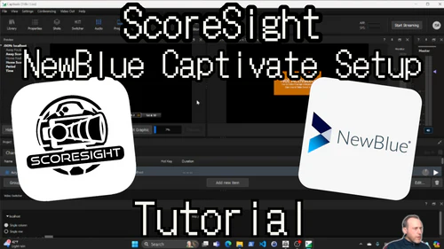

# NewBlue Captivate
{: .no_toc }

**Works, untested.** NewBlue Captivate is the new name of **NewBlue Titler Live** (since version 5.7, 2023), so these steps apply to both. Two ways: ScoreSight pushes the values to Captivate (push), or Captivate reads them from ScoreSight (pull). In both, name the graphic's text variables exactly like the ScoreSight fields (`Home Score`, `Away Score`, `Time`...).

<a href="https://youtu.be/ptR-Yh5FSPg" target="_blank" rel="noopener"></a>

The video shows an earlier version of ScoreSight; the steps below are for the current one.

<details open markdown="block">
  <summary>On this page</summary>
  {: .text-delta }
1. TOC
{:toc}
</details>

## Push: ScoreSight sends the values

For Captivate Broadcast. Whether the Sport edition accepts it is unverified.

1. In Captivate's Designer, make the graphic's text layers variables named like the ScoreSight fields, and keep the changes. For a ready-made title, list its variables with `curl --data "{\"command\":\"readTitle\",\"parameters\":{\"title\":\"<Title Name>\"}}" -H "Content-Type: application/json" http://<captivate-ip>:9022/api/` and rename the ScoreSight fields to match (for example *Away Score* to *Visitor Score*).
2. In ScoreSight, select **HTTP API** in the Outputs list ([Outbound HTTP API](../out_api.md)) and set:
   - **URL**: `http://<captivate-ip>:9022/api/action/still/title/<Title%20Name>` (the title's name, percent-encoded; `update` instead of `still` animates the change; `/input/<input name>` instead of `/title/...` targets every title on an input);
   - method **POST**, **Encode** *JSON (Simple key-value)*;
   - **Send**: tick **Only changes**, so Captivate gets a request only when a value changed (leave **Fields** on *All in one request*).
3. Tick **Send out API requests to external services.** and allow TCP port 9022 through the Captivate computer's firewall.

To test without ScoreSight:

```sh
curl -H "Content-Type: application/json" --data "{\"Home Score\":\"21\"}" "http://<captivate-ip>:9022/api/action/still/title/<Title%20Name>"
```

## Pull: Captivate reads ScoreSight

For Captivate Sport and Broadcast.

1. Select the graphic, then **Select a data controller** > **General** > **JSON** > **New Input**.
2. Enter `http://<scoresight-ip>:18099/json?pivot&all` (the [HTTP server](../http_server.md)). Or use the XML reader with `http://<scoresight-ip>:18099/xml?pivot&all`, whose element names have no spaces: `HomeScore`.
3. Open **Link Data** and drag each variable onto its text object.

`&all` keeps every field in the data, with its last good value, so a variable never goes blank while a reading is rejected.

## Notes

- Captivate's documentation mentions network and FTP addresses for the readers; whether it accepts a plain `http://` address, and how often it reads it, isn't documented.
- Captivate's API needs nothing to be turned on, but port 9022 must be free when Captivate starts. NewBlue's comparison chart lists the API under Broadcast only.
- Captivate also takes the same JSON messages over TCP (port 9025) and UDP (port 9026), which the [TCP / UDP output](../tcp-output.md) could send with a Custom template. The HTTP route above is simpler.

## Vendor documentation

- [Simple Variable Update over HTTP](https://developers.newbluefx.com/captivate-api/advanced-api-reference/tcp-udp-and-http-connections)
- [Captivate renamed from Titler Live](https://newbluefx.com/blog/newblue-captivate-a-new-and-improved-titler-live/)
- [Connect JSON feed data to a graphic layer](https://newbluefx.zendesk.com/hc/en-us/articles/17148309903899-Connect-JSON-feed-data-to-a-graphic-layer)
